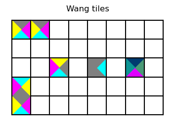
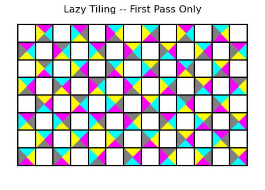
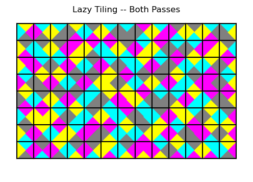
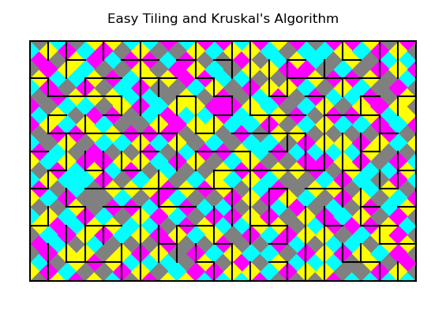

# Producing mazes with Wang tiles

## Contents

1. Data structures
2. The easy tiling algorithm
*  References

## 1. Data structures

### 1.1 Wang tiles

Wang tiles are small square tiles whose four sides have been been colored in various ways.  Let's make a few together...  Run the following code -- it's been packaged as demonstration module *demos.wang\_tiles\_1*:
```python
    # import a few things
from mazes.Grids.oblong import OblongGrid
from mazes.maze import Maze
from mazes.tetris.wang_tile import TileLayout, WangTile, SENW, CMYK
from mazes.Graphics.tiled_oblong import WangTileFill

    # unpack directions, colors
S, E, N, W = SENW
C, M, Y, K = CMYK

    # make five places to put the tiles
maze = Maze(OblongGrid(5, 8))
cell1a = maze.grid[0,0]; cell1a.label='1'
cell2 = maze.grid[1,0]; cell2.label='2'
cell3 = maze.grid[2,2]; cell3.label='3'
cell4 = maze.grid[2,4]; cell4.label='4'
cell5 = maze.grid[2,6]; cell5.label='5'
cell1b = maze.grid[4,0]; cell1b.label='1'
cell1c = maze.grid[4,1]; cell1c.label='1'
maze.link(cell1a, cell2)
print(maze)

placements = dict()             # cell:tile

    # make two tiles that fit together vertically
alpha = {S:C, E:M, N:K, W:Y}
beta = {S:K, E:Y, N:C, W:M}
print("α =", alpha)
print("β =", beta)
placements[cell1a] = WangTile(sigma=alpha)
placements[cell1b] = placements[cell1a]
placements[cell1c] = placements[cell1a]
placements[cell2] = WangTile(sigma=beta)

    # two more tiles, CMYK default layout
placements[cell3] = WangTile()
placements[cell4] = WangTile(sigma="r")

    # one with a five-color layou
tardis_blue = "#003B6F"
phlox = "#DF00FF"
atrovirens = "#0D9494"
feldgrau = "#4D5D53"
smaragdine = "#4A9976"
palette = (tardis_blue, phlox, atrovirens, feldgrau, smaragdine)
new_layout = TileLayout(colors=palette)
placements[cell5] = WangTile(layout=new_layout)
for cell in [cell3, cell4, cell5]:
    print(placements[cell])

    # display the maze
spider = WangTileFill(maze, placements)
spider.setup()
spider.title("Wang tiles")
spider.draw_maze()
spider.fig.tight_layout()
spider.show()
```

Here we run the demo from the mazes directory:
```
maze4c$ python -m demos.wang_tiles_1
Wang tiles introductory demo
+---+---+---+---+---+---+---+---+
| 1 | 1 |   |   |   |   |   |   |
+---+---+---+---+---+---+---+---+
|   |   |   |   |   |   |   |   |
+---+---+---+---+---+---+---+---+
|   |   | 3 |   | 4 |   | 5 |   |
+---+---+---+---+---+---+---+---+
| 2 |   |   |   |   |   |   |   |
+   +---+---+---+---+---+---+---+
| 1 |   |   |   |   |   |   |   |
+---+---+---+---+---+---+---+---+
α = {'south': 'cyan', 'east': 'magenta', 'north': 'grey', 'west': 'yellow'}
β = {'south': 'grey', 'east': 'yellow', 'north': 'cyan', 'west': 'magenta'}
WangTile[3]: {south:cyan, east:grey, north:yellow, west:magenta}
WangTile[4]: {south:grey, east:cyan, north:grey, west:grey}
WangTile[5]: {south:#DF00FF, east:#4A9976, north:#003B6F, west:#0D9494}
```
Results will vary from run to run. The maze displayed above is tagged to to the drawing that pops up:



**Figure 1.1**.  Results of the demo

Three cells are labelled #1 in the display.  Each of its edges is assigned according to the color map labelled α, for example the north (or top) edge is colored grey in each of these three cells.

Notice in the upper left corner that the east edge in the upper left corner cell is magenta but the west edge of its neighbor to the right is yellow.  These two tiles are considered "badly placed" as the rules of placement say that the color of connecting edges should be identical.

Tile #1 used for all three cells labelled #1 were created using the syntax:
```python
        WangTile(sigma=alpha)
```
where *alpha* is a dictionary object which maps directions to colors.  (The color names should be strings that *matplotlib* recognizes as color strings.  Direction names will depend on the type of grid. The implementation here is for a Von Neumann grid -- square cells with orthogonal neighbors.) Note here that we placed the same tile object simultaneously in three different cells:
```python
        placements[cell1a] = WangTile(sigma=alpha)
        placements[cell1b] = placements[cell1a]
        placements[cell1c] = placements[cell1a]
```

To the north of the cell in the lower left corner is a cell with color map β.  Notice that the north edge of the corner cell and the south edge of its neighbor are both grey.  These two tiles are "well placed" with respect to each other.

The default layout uses the colors cyan, magenta, yellow and grey.  (The first three are the standard pigments for CMYK color mapping.  We use grey as the key ("K") color instead of black so that we can distinguish between edges and walls can be distinguished.  Note that we have carved and edge between the two cells in the lower left.

Cell #3 has its edges colored with a random permutation of the CMYK colors.  Your results may vary but each color is used at most once.

The tile in cell #3 was created as follows:
```python
        WangTile()
```
The color map *sigma* is set to *None* by default.  Setting the option *sigma=None* colors the directions *without* replacement.

The tile in cell #4 was created as follows:
```python
        WangTile(sigma="r")
```
(The string "r" could be any string as only the type is checked.)  In this run, the result was a tile with 3 grey cells.  When *type(sigma)==str*, colors are assigned randomly *with* replacement.

We are not restricted to the colors cyan, magenta, yellow and grey.  The tile in cell #5 uses five somewhat arbitrary colors defined as RGB hexadecimal codes.  As there are only four directions, just four of the five colors are displayed on the tile.

### 1.2. Tile layouts

The *TileLayout* class is declared in module *mazes.tetris.wang\_tile*.  A default instance, *default\_tile\_layout*, is also defined there.  *TileLayout* objects define a set of directions, a map of opposing directions, and a set of colors.  For the default instance, the directions are *"south"*, *"east"*, *"north"* and *"west"* with *"north"* opposing *"south"* and *"east"* opposing *"west"*'; the colors *"cyan"*, *"magenta"*, *"yellow"*, and *"grey"*.

To a layout for a custom coloring, see the definition of *new\_layout* in the previous section.  For a layout customized for a grid other than *OblongGrid*, look at the source code for module *mazes.tetris.wang\_tile* to see how *default\_tile\_layout* was defined.

## 2. The easy tiling algorithm

Algorithm *EasyTiling* is defined in module *mazes.Algorithms.lazy\_wtiling*.  Note that all it does is drop tiles.  It does not carve a maze, but it does provide a way to (randomly) define edge priorities for use in Kruskal's algorithm or Prim's algorithm that use the coloring scheme.  It's a two-pass algorithm: in the first pass, randomly generated tiles are simply dropped into a specially chosen subset of the cells; in the second pass tiles are dropped into the remaining cells, taking care to insuring that these cells are "well-placed".

### 2.1 Pass 1

Let's start with the first pass...  First our results:



**Figure 2.1**.  First pass of the easy tiling algorithm

Notice that about half the cells have been tiled.  Now let's see how we produced the image in the Python interpreter.  We start by entering the interpreter and a few imports.
```
    maze4c$ python
    Python 3.10.12
    >>> from mazes.Grids.oblong import OblongGrid
    >>> from mazes.maze import Maze
    >>> from mazes.Algorithms.lazy_wtiling import EasyTiling
```

To stop at the end of pass 1, we define a subclass of *EasyTiling* which replaces method *pass2\_visit* in *EasyTiling.Status* -- four lines of code:
```
    >>> class Pass1(EasyTiling):
    ...     class Status(EasyTiling.Status):
    ...         def pass2_visit(self):
    ...             self.more = False  # stop now!
    ...
```

Now we prepare a *Maze* object and feed it into the algorithm.  We need to save the status in order to display the tiling:
```
    >>> maze = Maze(OblongGrid(8,13))
    >>> status = Pass1.on(maze)
    >>> print(status)
          Lazy Tiling (statistics)
                            visits      106
                        even cells       52
                         odd cells       52
```
The even cells are tiled in pass 1.  The odd cells are handled in pass 2.  By default, the even cells are the cells whose indices sum to an even number.  Remember that rows run south to north starting with row 0 and columns west to east starting with column 0.  (You can change the way the first pass drops tiles by supplying a custom *cell_selector* method.  You can also change the style of the tile by supplying a custom *tile_maker* method, or by supplying a custom tile *layout*.)

To get the picture, we need to use the appropriate graphics driver:
```
    >>> from mazes.Graphics.tiled_oblong import WangTileFill
    >>> spider = WangTileFill(maze, status.visited)
    >>> spider.setup()
    >>> spider.title("Lazy Tiling -- First Pass Only")
    >>> spider.draw_maze()
    >>> spider.fig.tight_layout()
    >>> spider.show()
```

### 2.2  Pass 2

Pass 2 does its best to fill the empty cells with tiles that are well-placed.  Let's take a look.  We use essentially the same code as above, but we don't define a new subclass.  Here's the result:



**Figure 2.2**.  Both passes of the easy tiling algorithm

And here is the session, starting with a few imports:
```
    maze4c$ python
    Python 3.10.12
    >>> from mazes.Grids.oblong import OblongGrid
    >>> from mazes.maze import Maze
    >>> from mazes.Algorithms.lazy_wtiling import EasyTiling
```

Next we create a *Maze* object and drop tiles into it:
```
    >>> maze = Maze(OblongGrid(8,13))
    >>> status = EasyTiling.on(maze)
    >>> print(status)
          Lazy Tiling (statistics)
                            visits      158
                        even cells       52
                         odd cells       52
```

Finally we prepare the picture:
```
    >>> from mazes.Graphics.tiled_oblong import WangTileFill
    >>> spider = WangTileFill(maze, status.visited)
    >>> spider.setup()
    >>> spider.title("Lazy Tiling -- Both Passes")
    >>> spider.draw_maze()
    >>> spider.fig.tight_layout()
    >>> spider.show()
```

Note in the picture the small colored squares that cover most of the grid.  Each of the small squares has a diagonal which is aligned along a grid edge and a diagonal which is perpendicular to the same edge.  Now the question becomes "Can we carve some of those edges to create an interesting maze?"  Well we can certainly carve some of the edges, and we can use the coloring to set some priorities -- and with edge priorities, we can carve a maze using Kruskal's algorithm or Prim's algorithm.

### 2.3  Easy tiling and Kruskal's algorithm

We will carry out the maze carving using Kruskal's algorithm.  Here is the maze that we created:



#### 2.3.1  Easy tiling

**Figure 2.3**.  Wang tiles and Kruskal's algorithm

If you look closely, cyan passages seem to be common and yellow passages seem to be rare. (Cyan is the blue-green shade.  There is a small cyan square that covers the edge between the cell in the lower left and its neigbor above.)  This is not a coincidence, but if you run the code below, you may see a different correlation between the edge colors and the passages that were carved.  More on this below.  Let's go to the actual code... most of the code is the same as the pass 2 code above.

We will use a larger grid.  First we need to color the edges:
```
    maze4c$ python
    Python 3.10.12
    >>> from mazes.Grids.oblong import OblongGrid
    >>> from mazes.maze import Maze
    >>> from mazes.Algorithms.lazy_wtiling import EasyTiling
    >>> maze = Maze(OblongGrid(13,21))
    >>> status = EasyTiling.on(maze)
    >>> print(status)
          Lazy Tiling (statistics)
                            visits      411
                        even cells      137
                         odd cells      136
```

#### 2.3.2  Kruskal's algorithm

So far, apart from the dimensions of the grid, nothing has changed.  Now we need to run Kruskal's algorithm.  The next line can be skipped, but we need it for our discussion of priorities:
```
    >>> status.set_priorities(debug=True)
    Priorities:
        0 - cyan
        1 - grey
        2 - magenta
        3 - yellow
```

After running the lazy tiling algorithm, we had almost everything that we needed for Kruskal's algorithm.  The edge priorities need to be established.  The *to\_priority* method in the *status* object will establish the priorities (by calling the *set\_priorities* method unless it has already been run) and then it will simply return priorities for each edge as requested.  So we import the *Kruskal* class and then run its class method *on*:
```
    >>> from mazes.Algorithms.kruskal import Kruskal
    >>> print(Kruskal.on(maze, priority=status.to_priority))
          Kruskal (statistics)
                            visits      421
                 components (init)      273
               queue length (init)      512
                             cells      273
                          passages      272
                components (final)        1
              queue length (final)       91
```

#### 2.3.3  Displaying the maze

And now we are ready to draw the maze.  We could use the daddy long legs driver (class *Pholcidae* in *mazes.Graphics.oblong1*), but we want to see the coloring as well as the maze, so we use the *WangTileFill* driver.  (I'd like to reserve the Huntsman Spider genus for a driver that takes a lot more effort to write.)
```
>>> from mazes.Graphics.tiled_oblong import WangTileFill
>>> spider = WangTileFill(maze, status.visited)
>>> spider.setup()
>>> spider.title("Easy Tiling and Kruskal's Algorithm")
>>> spider.draw_maze()
>>> spider.fig.tight_layout()
>>> spider.show()
```
The result is the drawing in *Figure 3.3* above.

#### 2.3.4  Color priorities

To get an idea of how the priorities work, let's count the passages by color.  We will let Python do the actual counting.  We need a structure to do the counting and we need to start the counts at zero:
```
    >>> tally = dict()
    >>> cell0 = maze.grid[1,1]
    >>> tile0 = status.visited[cell0]
    >>> for way in cell0.ways:
    ...     color = tile0.color_of(way)
    ...     tally[color] = 0
    ... 
```
Now we run through each cell -- for each passage from the cell, we add one to the count for the passage's color:
```
    >>> for cell in maze.grid:
    ...     tile = status.visited[cell]
    ...     for way in cell.ways:
    ...         nbr = cell[way]
    ...         if cell.is_linked(nbr):
    ...             color = tile.color_of(way)
    ...             tally[color] += 1
    ... 
```
Note that each passage was counted twice.  (We've done this before -- it's called Euler-counting in honor of Leonhard Euler (1707-1783).  It's actually one of his more trivial results, but often it takes a genius to make some of the simplest observations.)  Note that as a check, we made sure that each entry in the *tally* was even:
```
    >>> for color in tally:
    ...     assert tally[color] % 2 == 0
    ...     count = tally[color] // 2
    ...     print(f"{count:10}  {color}")
    ... 
             1  yellow
           128  cyan
            25  magenta
           118  grey
```
If we combine this table with the list of color priorities, we have:
```
    priority   color     passages
        0      cyan         128
        1      grey         118
        2      magenta       25
        3      yellow         1
                        -----------
                            272    total number of passages
```
And yes, the total is correct:
```
    >>> sum(tally[color] for color in tally)   # should be even!
    544
    >>> sum(tally[color] for color in tally) // 2
    272
```
The edge priorities computed above aren't actually equal to 0, 1, 2, or 3.  A tiny bit is added to make give each edge a unique priority.

#### 2.3.5  Distribution of colors overall

Note that some colors may be used in more triangles than others.  In pass 1, the numbers of triangles of each color are the same.  But pass 2 does not preserve this equality.  Let's count every triangle...
```
    >>> tally = dict()
    >>> for way in cell0.ways:
    ...     color = tile0.color_of(way)
    ...     tally[color] = 0
    ... 
    >>> for cell in maze.grid:
    ...     tile = status.visited[cell]
    ...     for way in cell.ways:
    ...         color = tile.color_of(way)
    ...         tally[color] += 1
    ... 
    >>> print(tally)
    {'yellow': 262, 'cyan': 256, 'magenta': 250, 'grey': 256}
```
So the colors are not distributed equally.  Note also that there are colored triangles along the border of the grid where there are no edges.
```
    >>> sum(tally[color] for color in tally)
    1024
```
There are 1024 triangles.  There are 13 each along the east and west grid borders and 21 each along the north and south borders, for a total of 68 border triangles.  That leaves 956 triangles in the grid's interior.  Divide by 2 to get the number of grid edges (or small colored squares): 478.

## References

[1] Ian Stewart. *Reaching out for the extreme*.  Princeton (2026), *pp* 43-44.